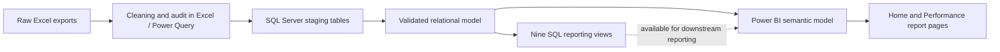
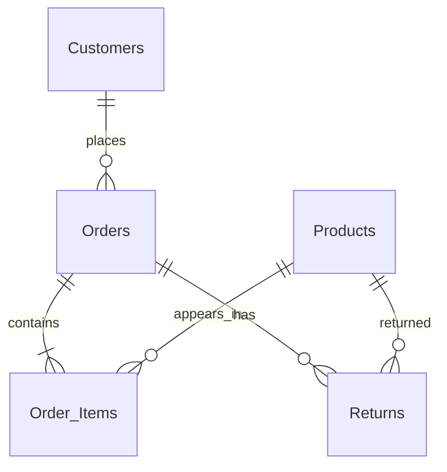

# UrbanCart | Retail Sales & Customer Analytics

**Excel data preparation · SQL Server analytics · Power BI reporting · Data-quality controls**

A portfolio-grade case study using a **synthetic Indian retail dataset** to answer practical questions about sales trends, product performance, customer segments, channels, fulfilment and returns. The project separates source data, transformation logic, business metrics and presentation so that the work is explainable and maintainable.

> **Repository status:** All six uploaded Excel, Power BI and reference/document files have been organized into the project folders and are available here. The uploaded Power BI file (1,662,323 bytes) differs from the earlier companion package (4,813,407 bytes) and is preserved as supplied. SQL Server execution and Power BI Desktop refresh still require independent verification.

## At a glance

| Area | Details |
|---|---|
| Business | UrbanCart, a **fictional** online and physical retail brand |
| Stack | Excel / Power Query, SQL Server (T-SQL), Power BI Desktop, Python |
| Coverage | Orders dated **2023–2025**; amounts in **INR** |
| Input model | Customers, Products, Orders, Order_Items, Returns |
| Analytical model | Relational tables, 9 reporting views, 5 core DAX measures |
| Principal KPIs | Gross sales, order volume, AOV, customer count, order return rate |
| Assurance | Versioned SQL, defensive load checks, documented caveats, CI |

## Business goals

1. Assess gross sales over time and by region, product and channel.
2. Compare customer segments, order value and repeat purchase behaviour.
3. Understand return incidence and delivery performance.
4. Distinguish trustworthy results from synthetic-data anomalies.

## Project architecture

## Repository map

| Path | Purpose |
|---|---|
| [sql/01_schema_and_load.sql](sql/01_schema_and_load.sql) | Stage checks, safe duplicate handling, model DDL, load and reconciliation |
| [sql/02_analysis_and_views.sql](sql/02_analysis_and_views.sql) | Nine reporting views and executable business queries |
| [sql/03_advanced_analytics.sql](sql/03_advanced_analytics.sql) | Monthly growth, running totals, product ranking, anomaly review |
| [powerbi/](powerbi/) | [Power BI report](powerbi/UrbanCart_Dashboard.pbix), DAX reference and report handover |
| [data/](data/) | [Raw Excel](data/raw/UrbanCart_Raw_Sales_Data.xlsx), [cleaned Excel](data/cleaned/UrbanCart_Cleaned_Sales_Data.xlsx) and dataset notes |
| [docs/](docs/) | Setup, architecture, [BRD](docs/UrbanCart_Business_Requirement_Document.docx), [walkthrough](docs/UrbanCart_Project_Walkthrough.pptx), [HTML reference](docs/UrbanCart_Dashboard_Reference.html) and quality audit |
| [scripts/validate_repository.py](scripts/validate_repository.py) | Standard-library source integrity checks |
| [.github/workflows/validate.yml](.github/workflows/validate.yml) | Automatic validation on pushes and pull requests |

All tracked files are populated; no empty placeholder files are intentionally committed.

## Data inventory

| Entity | Source rows | Cleaned rows | Intended SQL rows |
|---|---:|---:|---:|
| Customers | 3,060 | 3,000 | 3,000 |
| Products | 161 | 156 | 156 |
| Orders | 10,000 | 10,000 | 10,000 |
| Order_Items | 20,643 | 20,643 | 20,523 |
| Returns | 793 | 793 | 793 |

The **120 duplicate order-line IDs** are removed from SQL staging *after inspection*, not silently deleted from the cleaned workbook. Entity grain and field contracts are in [data/README.md](data/README.md).

## Selected descriptive results

These observations were calculated for the supplied cleaned data after SQL staging de-duplication; they are **not live production figures**.

| Metric | Result |
|---|---:|
| Gross sales (including flagged high-quantity lines) | Approx. **₹818.2 million** |
| Distinct orders | **10,000** |
| Ordering customers | **2,878** |
| Average order value | Approx. **₹81,822** |
| Order return incidence | **7.93%** |

**Interpretation is essential:** 112 order lines have quantity 500 and contribute approximately 61% of reported gross sales. Zero-quantity records and inconsistent delivery dates also exist. The project **retains** them and exposes them for review rather than creating artificially clean results. Details: [docs/DATA_QUALITY.md](docs/DATA_QUALITY.md).

## Reproduction

**Prerequisites:** SQL Server 2017+ for `TRIM`, SSMS or equivalent client, Excel/Power Query, Power BI Desktop and Python 3.11+ for repository checks.

1. Download the [raw](data/raw/UrbanCart_Raw_Sales_Data.xlsx) and [cleaned](data/cleaned/UrbanCart_Cleaned_Sales_Data.xlsx) workbooks from this repository and check their identity in [the asset manifest](docs/ASSET_MANIFEST.md).
2. Inspect the cleaned workbook's five `*_Clean` sheets, then import those sheets to the staging tables described in [docs/SETUP.md](docs/SETUP.md).
3. Set up a database named `UrbanCart`; review and execute `sql/01_schema_and_load.sql` **in order**. It is intentionally not a blind, repeatable schema migration.
4. Execute `sql/02_analysis_and_views.sql` and the optional `sql/03_advanced_analytics.sql`.
5. Open the [uploaded Power BI report](powerbi/UrbanCart_Dashboard.pbix) in Power BI Desktop, update its SQL Server connection, and refresh. Its current contents and runtime behaviour have not been validated. Follow [powerbi/README.md](powerbi/README.md).
6. Run `python scripts/validate_repository.py` to check the **tracked source package**. This check does not run SQL Server or validate a Power BI refresh.

See [the detailed setup guide](docs/SETUP.md) before executing SQL, especially if using an existing database.

## Metric policy

- **Gross sales** = `SUM(Order_Items.LineTotal)` after staging de-duplication. It does **not** subtract refunds or add shipping.
- **Order count** = distinct `Orders.OrderID`, not line-item count.
- **AOV** = gross sales / distinct orders.
- **Return rate** = distinct orders with a return / distinct orders, not units returned.
- **Delivery time** excludes physically invalid ship/delivery sequences.

The complete definitions and assumptions are documented in [docs/METRICS.md](docs/METRICS.md).

## Engineering standards and limitations

- Raw business facts are not silently rewritten to improve headline KPIs.
- SQL staging is distinct from curated analytical tables; destructive work requires inspection and transaction protection.
- The supplied report currently uses automatic date hierarchies; a dedicated date dimension is recommended.
- Dataset is synthetic: this is **not** a commercial UrbanCart product, official retailer endorsement or production deployment.
- No fabricated performance claims, job tenure or certification claims appear in this repository.
- Executable SQL and Power BI model behaviour must be verified in the respective applications.

## Documentation

[Setup](docs/SETUP.md) · [Architecture](docs/ARCHITECTURE.md) · [Metric definitions](docs/METRICS.md) · [Quality review](docs/DATA_QUALITY.md) · [Asset manifest](docs/ASSET_MANIFEST.md) · [Roadmap](docs/ROADMAP.md) · [Contributing](CONTRIBUTING.md) · [Changelog](CHANGELOG.md)

---

**Maintained by** [bhagabatabrahma0106-dotcom](https://github.com/bhagabatabrahma0106-dotcom) · For technical review and learning. Dataset and source provenance are described in the documentation.
